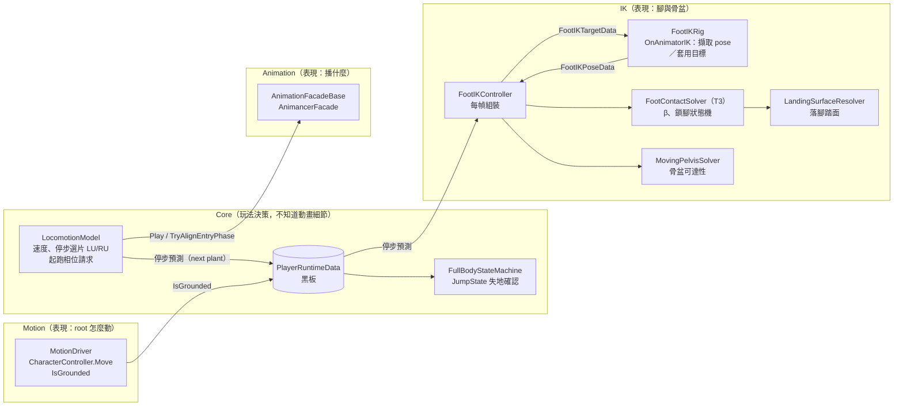
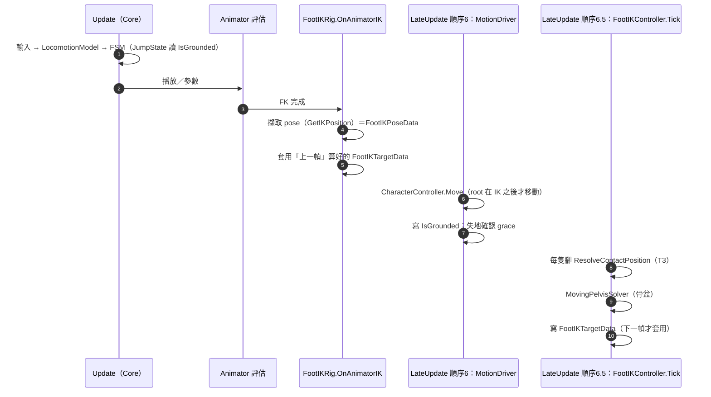
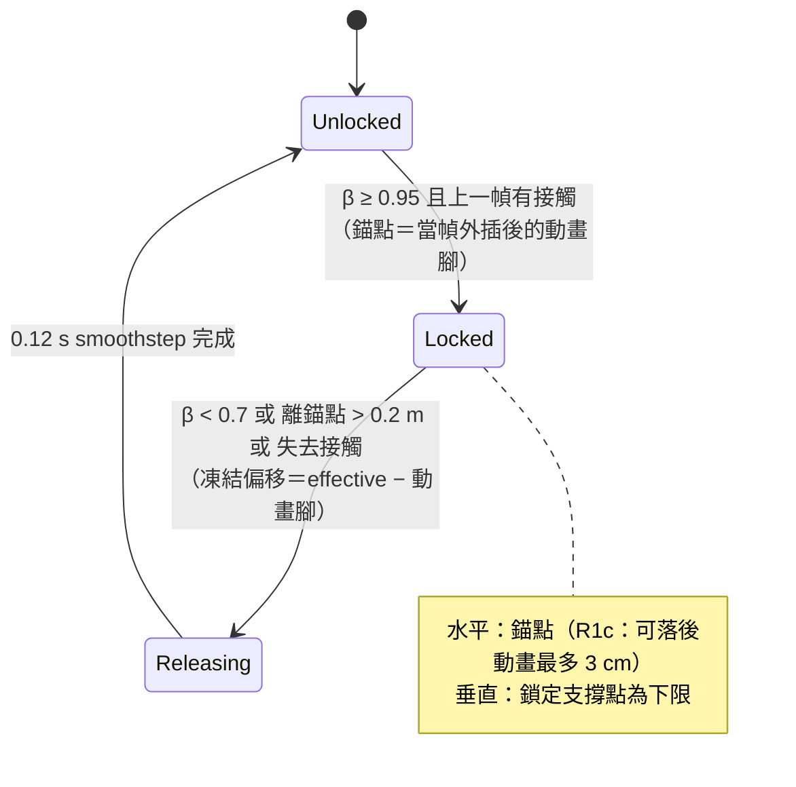

# 49 — 腳與地面的接觸：Foot IK 樓梯與停步技術導讀

> **文件定位**：技術學習與實作導讀。透過 Unity 角色在樓梯移動、停步與起跑時遇到的腳部接觸問題，介紹 Foot IK 的基本原理、接觸狀態管理、骨盆補償，以及相關的診斷與驗證方法。
> **閱讀方式**：由基礎概念開始，逐步理解系統架構、每幀執行流程與具體演算法，再透過實際開發案例觀察問題如何被定位、修正及驗證。
> **閱讀前提**：具備基本的 Unity、Transform 與角色動畫概念。尚未接觸 IK 的讀者，可從第 1 層開始閱讀。
> **文件範圍**：本文以專案中的 T3 腳部接觸系統為實例，說明一種具體的工程實作方式，而非將專案中的設計視為所有角色控制器通用的最佳解。
> **相關文件**：`docs/29`、`docs/45`、`docs/46`、`docs/ADR/010`、`docs/ADR/011`。

## 學習目標

閱讀本文後，應能理解：

1. FK、IK 與腳部接觸修正之間的關係。
2. 為什麼平地動畫在樓梯、斜坡與停步時容易出現穿透、懸空或滑步。
3. 如何利用接觸相位、腳部鎖定與地面查詢建立 Foot IK 系統。
4. 骨盆高度修正與雙腳可達性之間的關係。
5. 如何區分動畫素材、角色位移與 IK 修正所造成的視覺問題。
6. 如何使用量測、離線重播及 A/B 測試驗證修正效果。

本文中的具體數值、演算法與測試結果皆對應到實際專案版本。讀者應理解其設計依據與適用限制，而非直接將參數視為通用設定。

---

## 第 0 層：30 秒版本

**問題**：遊戲角色的腳是動畫決定的，動畫假設地面是平的。角色走上樓梯時，腳會穿進台階、懸在空中；停下來時，腳會像被磁鐵吸到落腳點。

**做了什麼**：在動畫之上加一層「腳部接觸」系統（內部代號 **T3**）——它判斷每隻腳此刻是在**擺盪**還是**踩住**，擺盪時保留動畫的抬腳高度、落地時貼上真正的踏面、踩住後把腳鎖在原地；骨盆依兩腳搆得到的範圍決定身體高度。

**怎麼證明**：每一個改動都先量測再改——用自動化探針跑上百次停步，把「動畫原本的腳」「系統算出的目標」「玩家看到的腳」三條軌跡逐幀對齊比較。結論常常和直覺相反：例如「停步時腳被吸過去」不是動畫的問題，而是鎖腳機制把慢速移動藏起來、最後一次補回造成的（§5.5）。

| 給誰 | 一句話 |
|---|---|
| HR | 讓 3D 角色在樓梯上走、停、起跑時，腳自然地踩在台階上 |
| 用人主管 | 解決「動畫假設平地」與「真實地形」的落差；每個修正都有量測與回歸測試 |
| 技術面試官 | 接觸相位 β ＋ 鎖腳狀態機 ＋ 參考面擺盪 ＋ 可達性骨盆求解；離線重播（與 runtime 99.95% 一致）先篩候選再 A/B；所有被否決方案都留有證據 |

---

## 第 1 層：基本概念（給沒做過 IK 的人）

### 1.1 FK 與 IK
- **FK（Forward Kinematics）**：動畫直接給每根骨頭的角度，腳在哪裡是「算出來的結果」。
- **IK（Inverse Kinematics）**：反過來——先指定「腳要在這裡」（**IK goal**），由解算器回推膝蓋、髖部怎麼彎。
- Unity Humanoid 每幀在 `OnAnimatorIK` 回呼裡讓我們：①讀到 FK 算出來的腳位置（`GetIKPosition`）②設定新的目標與**權重**（0＝照動畫、1＝完全照目標）③調整身體（骨盆）位置。

### 1.2 為什麼樓梯特別難
1. **角色的碰撞體走的不是台階**。樓梯上 CharacterController 碰的是一塊**平滑斜面**（`__StairMovementSurface`，避免一階一階頂撞造成抖動）；看得到的台階在另一個 layer，只有腳的射線查得到（`docs/44`）。
   ⇒ root（角色原點）沿斜面平滑移動，但腳要踩在一階一階的踏面上。兩者每幀差 5–20 cm。
2. **台階是不連續的**。腳往前移 1 cm 可能就從這一階跨到下一階——腳下高度瞬間跳 19.5 cm（級高）。
3. **動畫只知道平地**。動畫裡的「抬腳高度」是相對平地的；停步動畫的收腳步可能只抬 8 cm，比一階還矮。

### 1.3 v2 做法的極限（為什麼要 T3）
`docs/29` 的 v2：每幀在腳正下方打射線找地面，用權重把腳拉過去。問題：
- 擺盪中的腳也被拉向「它正下方」的台階 ⇒ 跨階時目標跳 9–15 cm（p99）。
- 踩住的腳每幀重新查地面 ⇒ 腳一滾動、端點跨過階緣，就整隻腳跳一階。
- 權重只是「多用力」，不知道「這隻腳現在該不該在地上」。

外部參考（UE `AnimNode_FootPlacement`、Assassin's Creed Syndicate GDC 2016、Johansen 2009）一致的做法是：**擺盪沿連續的參考面、落腳交給真實接觸面、踩住就鎖** ⇒ T3（`docs/45` §1–§4）。

---

## 第 2 層：架構——誰負責什麼

### 2.1 分層



**依賴方向**（CLAUDE.md）：Input → Pipeline → RuntimeData → StateMachine → Animation → Motion。IK 是 Presentation 的一部分，只**讀**黑板，不回寫玩法狀態。

### 2.2 兩條單向共享資料
| 資料 | 誰寫 | 誰讀 | 內容 |
|---|---|---|---|
| `FootIKPoseData` | `FootIKRig`（`OnAnimatorIK`） | `FootIKController` | 本幀 FK 的腳位置／旋轉、pose 平面高度 |
| `FootIKTargetData` | `FootIKController` | `FootIKRig`（**下一幀** `OnAnimatorIK`） | 兩腳目標、權重、骨盆偏移 |

Controller 與 Rig 之間沒有方法呼叫，只有這兩份資料——好處是時序可推理、可測試。

### 2.3 三個不同的「地面」（最容易混淆）
| 名稱 | 是什麼 | 誰用 |
|---|---|---|
| 移動面（movement surface） | 樓梯上的平滑斜面 collider | CharacterController；T3 的**擺盪參考** |
| 踏面（tread） | 看得到的台階頂面 | T3 的**接觸**與鎖定支撐 |
| pose 平面 | 動畫評估當下 root 的高度 | 判斷「動畫裡這隻腳離地多高」（stance） |

---

## 第 3 層：每幀呼叫鏈

### 3.1 一幀的時間順序



**三個時序事實**（後面每一項技術都建立在這上面）：
1. **目標下一幀才套用** ⇒ T3 要把動畫腳「外插一幀」（pose ＋ 上一幀位移），否則擺盪腳永遠落後 7–16 cm。
2. **root 在 IK 之後才移動** ⇒ 比較「動畫腳」與「畫面腳」時要補上這一幀的 root 位移（§6.2）。
3. **`GetIKPosition` 是 IK goal 空間，不是骨骼位置**：兩者固定差約 6 cm。權重 1 時骨骼正好落在 goal 上——所以比較要在同一個空間做。

### 3.2 `ResolveContactPosition`：一隻腳的 T3 管線
`Assets/Scripts/Presentation/IK/FootIKController.cs`（`ResolveContactPosition`）

```
① PredictPose        pose ＋（pose − 上一幀 pose）＝ 一幀外插；瞬移（>0.5 m/幀）⇒ 重設
   └ P8b             若這隻腳是「下一個預定落點」且很近 ⇒ 不外插（§5.4）
② ComputeContactBeta β ＝ stance × (1 − smoothstep(1, 4 m/s, 動畫腳水平速度))
   StepLock          Unlocked →(β≥0.95)→ Locked →(β<0.7／離錨點>0.2 m／失去接觸)→ Releasing →(0.12 s)→ Unlocked
   ResolveHorizontal Locked：錨點（R1c：動畫腳＋最多 3 cm 的落後，§5.5）；Releasing：動畫＋衰減中的凍結偏移
③ 擺盪參考           該水平位置下方的移動面 ＋ 動畫離地高度
   └ SwingFootLength 參考面取腳跟／腳踝／腳尖三點下方移動面的最高者（§5.2）
④ 接觸               以即將顯示的腳朝向取腳跟／腳踝底／腳尖三點，各自查踏面
                     lift ＝ 穿透 ? 全部抬起 : β × 懸空量（擺盪保留高度、落地才貼上）
                     Locked 期間：鎖定當幀那一點的踏面高度作為下限（不會因滾動跳階）
⑤ LandingSurfaceResolver（只在 Unlocked）：停步中已知下一個落點 ⇒ 參考面提前升／降到目的踏面（§5.1）
⑥ ResolveHeight      釋放中高度從鎖定高度平滑回到即時高度
```

### 3.3 鎖腳狀態機（T3 的核心）



β 只看**速度**：動畫腳 ≤ 1 m/s 就是 1，≥ 4 m/s 就是 0。這個簡單規則是 §5.5 那個問題的根源，也是它的解法所在。

---

## 第 4 層：骨盆——身體高度怎麼決定

腳只能伸到腿長那麼遠。台階讓兩腳高度不同時，骨盆必須降低，否則高的那隻腳會「搆不到」而懸空或膝蓋過直。

`docs/46` §6 的統一模型（`MovingPelvisSolver`）：

```
每隻腳提供一個上限：
  踩住的腳（Support）   U = LegBound(下一幀髖位置, 腳目標, 腿長)
  落地中的腳（Landing） U = LegBound(...) + κ × 腳離地高度   （預先準備）
目標高度  g = clamp( min(動畫想要的高度, 所有上限), −0.35 m, 0 )
步進      非對稱臨界阻尼：往下快（ω_down 12，跟上約束）、往上慢（ω_up，決定每步起伏）
硬上限    1.05 × 腿長：超過就直接夾住
```

- **為什麼非對稱**：可達需求在每一步內變化約 20 cm。對稱的求解器每步都會回到原高度再降下 ⇒ 身體每步上下 20–25 cm。往上慢＝允許的「步伐起伏」預算。
- **為什麼要量最終骨骼**：`PelvisOffsetY` 只是修正量；動畫本身就有 6.5–11.6 cm／步的起伏。量錯會得到相反結論（`docs/46` §30：改量最終骨骼後，結論從「骨盆太平穩」翻成「整體下蹲＋Walk 上樓過顛」）。
- 下樓時回升速度依方向分開（ω 6），停步時正在落地的尾腳也能往下拉（`docs/46` §33–§35）。

---

## 第 5 層：近幾輪的七項技術（每項：問題 → 量測 → 做法 → 結果 → 取捨）

### 5.1 落腳踏面解析（`LandingSurfaceResolver`）
- **問題**：擺盪腳的參考面追著「腳**目前**在哪一階」走，跨到不同階時，在鎖定前 1–4 幀才切換 ⇒ 單幀跳 8–17 cm。
- **量測**：208 次停步（兩道樓梯 × Walk／Run × 上／下 × 斜向 0°／20°）。發現停步預測（ADR-010 的 *next plant*）早 7–23 幀就指向最終那一階。
- **做法**：Core 的 `LocomotionModel` 在停步時把「下一個預定落點」發布到黑板（ADR-010 D5）；T3 在擺盪中（只在 Unlocked）讀它，接近落點時把參考面提前移到目的踏面；首次承諾需連續 2 幀、改答案需 3 幀；最後 3 幀用即時踏面驗證。
- **結果**：上樓跨階跳動 Run 17 → 6 cm、Walk 19 → 9 cm；下樓不變（幾何限制）。
- **取捨**：只有停步時有可信的落點；正常走路時不猜。即時驗證**只能驗證、不能產生**意圖（否則每幀改答案）。

### 5.2 擺盪腳長參考（`SwingFootLengthReference`）
- **問題**：上樓時腳尖／腳跟先伸進下一階的立面（riser），整隻腳被一幀抬起（「瞬拉」）。
- **否決的方案**：把「鎖定中的 riser 侵入規則」擴到擺盪——侵入一開始就 4–9 cm 深，腳鎖到錯的階、骨盆跳 13.7 cm。
- **做法**：擺盪參考面取腳跟／腳踝／腳尖三點下方移動面的**最高者**（原本只看腳踝）——每一點都保有自己的動畫離地高度。
- **結果**（416 次停步 A/B）：Walk 上樓單幀 ≥ 8 cm 的瞬拉次數，停步 175 → 71、移動中 177 → 79；Run 上樓只降到 155（剩下的屬外插與其他來源，由 §5.4 處理）。

### 5.3 統一骨盆求解器
見第 4 層。重點是**一個模型**同時處理移動、停步、站立，不是三套規則各自決定高度（`docs/46` §12–§14）。

### 5.4 Plant-aware 外插（P8b）
- **問題**：一幀外插在煞車步急停時會**過衝**——動畫腳已經停了，外插還往前推 5–10 cm，有時推到別階，下一幀再拉回。
- **量測**：in-engine 反事實——同一條 T3 支撐規則，比較外插比例 k ∈ {0, .25, .5, .75, 1} 與九種策略。只有停步預測「看得到未來」。
- **做法**：若這隻腳是下一個預定落點，且離落點 1.5 步以內 ⇒ 不外插；其餘依腳速衰減。
- **結果**（在 R1c 基線上重量）：錯階暫態 15 → 2、鎖定當幀的晚修正 max 5.3 → 2.0 cm；代價：落地前幾幀畫面腳加速度中位 +2.8 cm。

### 5.5 收步「吸附感」：診斷到修正（R1c）——本文的主案例
這一節示範完整的研究流程，建議細讀。

**症狀**：停步時，腳像被快速拉到最後的落腳點。

**三個假設**（不預設答案）：
- H1：停步動畫本身把收腳壓縮在最後幾幀。
- H2：T3 提早鎖定／修正造成。
- H3：兩者都有。

**量測設計**：
- 三條軌跡逐幀對齊：**A 動畫腳**（`pose + (root − 動畫評估時的 root)`）、**B T3 目標**（上一幀目標＋本幀 root 位移）、**C 畫面腳**（最終骨骼）。
- 三種 A 互相驗證：A0 離線純 clip 取樣（沒有 crossfade、沒有 IK）、A1 runtime pose、A2 runtime 把 IK 輸出歸零的反事實。
- 驗證門檻：IK 開啟時 |C − B| 中位 **0.000 cm**；runtime 最後一步與純 clip 差 0.3–0.6 cm。

**結果**：
| | 最後 100 ms 剩餘行程 | peak 速度 |
|---|---|---|
| Run loop（正常跑步落地） | 22–35 cm | 7–10 m/s |
| 停步最後一步 | **6–10 cm** | **0.8–2.7 m/s** |
⇒ H1 不成立：停步動畫的收腳**比正常跑步還慢**。

真正的機制在 T3：
```
動畫腳慢速移動（< 1.4 m/s）  →  β = 1  →  Locked，畫面腳不動
動畫在鎖下繼續走 9–11 cm      →  差距累積
β 掉到 0.7                     →  Releasing，0.12 s 內補回整段差距
⇒ 畫面上最後一步比動畫快 1.26–1.60 倍 ＝「被吸過去」
（正常跑步也有同一機制，但腳本來就快，只快 1.03–1.13 倍，看不出來）
```

**修法的篩選（先離線重播，不改 runtime）**：
1. 把 T3 的鎖定／釋放邏輯移植到 Python，對 24 個錄影重播——相位逐幀一致 **99.95%**、水平誤差 p99 **0.02 cm**（重播＝T3，才能信候選結果）。
2. 十九個候選：
| 候選 | 結果 |
|---|---|
| 縮小 UnlockRadius／距離持續增加就提早釋放 | ❌ 釋放後又重鎖、循環補回，最差 ×4–10；可見滑動 13–19 cm |
| 進鎖前要求腳速穩定（R2） | ❌ 不解決最後一步；只是不鎖 ⇒ 爬行全部看得到 |
| 補回速度上限（safety） | ❌ 差距一直拖著，loop 出現 13 cm 拖曳 |
| **R1c：鎖定點有限度跟隨** | ✅ 最後一步 ×1.08–1.20；鎖定次數與時刻不變；loop 幾乎不變 |

**R1c 的語意**：Locked 仍是 Locked；只是輸出位置 ＝ 動畫腳 ＋ clamp(錨點 − 動畫腳, 3 cm)。動畫腳離錨點 ≤ 3 cm 時與原本完全相同；超過時，腳以**動畫自己的速度**跟上，永遠只落後 3 cm ⇒ 釋放時最多補回 3 cm。

**實作前的 consumer 審查**：誰讀了 Locked？逐一確認它們要的是「這隻腳仍可靠」還是「世界座標零位移」。只有一個停用中的骨盆原型鎖存了世界座標 ⇒ 記錄為不相容，不修。

**runtime A/B（72 次）**：數字與重播一致；lock／release 次數、最終踏面、骨盆完全相同。樓梯上找到兩個垂直小問題並記錄（§24.5）。**使用者 Play 選 3 cm**（5 cm 仍看得到補回、小步像碎步）。

### 5.6 起跑入場相位對齊（ADR-011）
- **問題**：靜止後起跑，支撐腳貼地拖行 20–34 cm。
- **原因**：Idle 與 Run 共用一個混合樹；起跑時 Run 子動畫從它當時剛好在的相位開始，常常是錯的腳在地上。
- **做法**：起跑那一幀，請 Animation 層把 Run 子狀態對齊到 loop 的「左腳著地極值」相位——相位**由烘焙的腳相曲線算出**（φ≈0.91），不是手填。Core 只說「下一個循環從這個相位開始」，不知道混合樹與子狀態（facade 後端只重設權重 0、畫面上看不到的子狀態）。
- **結果**：動畫腳貼地滑動 20–34 → 9–10 cm。剩下 ~12 cm 是 root 從 0 加速、但 loop 姿勢假設全速造成的——**接受為動畫限制**，不讓 T3 藏起來（ADR-011 Accepted）。
- **為什麼要 ADR**：Core 第一次主動要求 Animation 改變子狀態播放相位——新的跨層 contract。

### 5.7 失地確認的決定性（determinism）
- **現象**：同一個測試連跑兩次，角色從樓梯頂跑出去後，「進入 Falling 動畫」的幀數會差 1。
- **定位**：root 軌跡、下落速度兩次完全相同，只有狀態切換差一幀 ⇒ 不是物理，是計時。
- **根因**：`fallEntryGrace`（0.35 s）與 `groundEdgeEventGrace`（0.1 s）用 `Time.time` 的**絕對時刻相減**。1/60 步長下 0.1 s 剛好 6 幀，float32 誤差讓「6 幀是否 ≥ 0.1」取決於 `Time.time` 已經多大（43–61% 的起點 6 幀通過，其餘要 7 幀）。
- **做法**：改成「從 0 累積每 tick 的 dt」，以 `Time.frameCount` 確保同一幀被問兩次只累積一次。門檻仍是**時間**，不是幀數（不綁死 60 Hz）。
- **證明**：先寫測試在舊程式上重現（8 個 case 紅：7≠6、22≠21），修完全綠；連跑兩次 36 個樓梯探針，gameplay 輸出 36／36 相同。

---

## 第 6 層：方法論（可以帶走的東西）

### 6.1 先量再改；不預設答案
每一輪的開場都是：寫下互斥的假設 → 設計能區分它們的量測 → 量完才決定改哪一層。§5.5 的「吸附感」直覺上是動畫問題，量測證明是 T3。

### 6.2 時間基準與座標空間要先驗證
量測錯了，後面所有比較都失去意義。這個專案踩過的：
- 在協程裡讀骨骼＝**上一幀**的姿勢。要在 `LateUpdate`（最後執行）讀最終骨骼。
- root 在 IK 之後才移動 ⇒ 動畫腳要補上 `root − rootEval`。
- IK goal 與骨骼差 6 cm ⇒ 在同一空間比較。
- 方法：先做**一致性驗證**（例如 |畫面 − 目標| 應為 0），通過才看數字。

### 6.3 離線重播 → runtime A/B → 人工 Play
| 階段 | 成本 | 用途 |
|---|---|---|
| 離線重播（Python） | 秒級、可跑十九個候選 | 篩掉明顯不行的；**前提是重播與 runtime 一致**（99.95%） |
| runtime A/B（PlayMode 探針） | 分鐘級 | 驗證重播沒有模擬到的部分（例如樓梯垂直） |
| 人工 Play | 人的時間 | 「自然不自然」只有人能判斷——只留給這件事 |

離線模型會漂移：另一輪曾用自己重寫的規則得到 204／247 一致，改成**反射呼叫原始程式**才 247／247。

### 6.4 分層比較，不要把探針雜訊升級成 regression
§5.7 中，第一層（探針自己的反事實射線）偶爾不同，第二層（IK／骨盆輸出）、第三層（locomotion 狀態）完全相同 ⇒ 不是 runtime 問題。

### 6.5 治理：Trial ADR 與 Living Spec
- 只有**跨系統契約**改變（黑板、FSM、管線順序、核心介面）才開 ADR；ADR 先是 **Trial**（可依實作修訂），驗證通過才 **Accepted**（凍結）。
- 單一子系統內的語意改變（例如 R1c 改的是 T3 內部的 Locked 輸出）寫進 Living Spec，不開 ADR。
- 每個實驗都是**預設關閉的開關**，關閉時與舊版逐位元相同；只在 X Bot 上開；還原＝把開關設回 false。

### 6.6 動畫資產的升級順序
資料／runtime 參數 → Presentation（混合、transition、播放速度）→ 換 clip → 最後才改 clip 內容。§5.5 的量測顯示 clip 本身不快、播放速度與 loop 相同 ⇒ 沒有理由動資產。

---

## 第 7 層：練習與重現

### 7.1 自我檢查題
1. 為什麼 T3 要外插一幀？如果不外插，擺盪腳會怎樣？
2. β 只看速度。舉一個「速度低但不該鎖」的情況（提示：§5.5、§5.6）。
3. 為什麼擺盪時用「移動面」當參考，而不是腳正下方的踏面？
4. R1c 為什麼不會增加鎖腳次數？（提示：它沒有改 `StepLock` 的判準。）
5. 為什麼「改成 6 幀」不是 §5.7 的好修法？
6. 統一骨盆求解器為什麼往下快、往上慢？
7. 拿到一個「看起來不自然」的回報時，你會先量哪三條軌跡？

### 7.2 自己跑一次
```bash
# PlayMode 探針（Unity Editor 開著；全部是 [Explicit]）
unity cmd run_tests --mode PlayMode --async_tests true --include_explicit true --filter "Project.Tests.PlayMode.PlantSettleProbe.Probe_StopSnapFlat"
```
- 輸出在 `Temp/PlantSettle/`（Unity 重啟會清空，跑完立刻複製出來）。
- 分析腳本：`docs/artifacts/stop-snap/`（`tl.py.txt` 單腳逐幀、`replay.py.txt` 離線重播、`ab.py.txt` A/B）、`docs/artifacts/plant-settle/`。
- 純函數測試：`FootContactSolverTests`、`LandingSurfaceResolverTests`、`MovingPelvisSolverTests`、`GroundLossGraceDeterminismTests`。

### 7.3 程式索引
| 檔案 | 角色 |
|---|---|
| `Assets/Scripts/Presentation/IK/FootIKRig.cs` | `OnAnimatorIK`：擷取 pose、套用目標 |
| `Assets/Scripts/Presentation/IK/FootIKController.cs` | 每幀組裝：`Tick` → `ResolveContactPosition` → `ResolveUnifiedMoving` |
| `Assets/Scripts/Presentation/IK/FootContactSolver.cs` | T3 純函數：`PredictPose`、`ComputeContactBeta`、`StepLock`、`ResolveHorizontal`、`ClampLockOffset` |
| `Assets/Scripts/Presentation/IK/LandingSurfaceResolver.cs` | 落腳踏面（純邏輯、零 GC） |
| `Assets/Scripts/Presentation/IK/MovingPelvisSolver.cs` | 骨盆可達性求解 |
| `Assets/Scripts/Presentation/IK/FootIKSettings.cs` | 所有開關與參數 |
| `Assets/Scripts/Core/Movement/Models/LocomotionModel.cs` | 停步選片、停步預測、起跑相位請求 |
| `Assets/Scripts/Core/Blackboard/LocomotionStopPrediction.cs` | ADR-010 停步預測快照 |
| `Assets/Scripts/Presentation/Animation/AnimancerFacade.cs` | `TryAlignEntryPhase`（ADR-011） |
| `Assets/Scripts/Presentation/Motion/MotionDriver.cs` | root 移動、`IsGrounded`、落地／離地事件 |
| `Assets/Scripts/Core/StateMachine/States/JumpState.cs` | 非主動失地 → Falling |

### 7.4 名詞
| 名詞 | 意思 |
|---|---|
| IK goal | IK 要讓腳到的位置 |
| β（contact phase） | 0＝擺盪、1＝落地；由動畫腳速度與離地高度算出 |
| stance | 動畫裡這隻腳貼地的程度（離 pose 平面 8–25 cm 之間線性） |
| Locked／Releasing | 鎖住水平位置／從鎖定點平滑回到動畫 |
| 錨點（LockPosition） | 鎖定當幀的位置 |
| 移動面／踏面 | 角色碰撞走的斜面／看得到的台階 |
| next plant | 停步預測給出的「下一個預定落點」 |
| re-step | 同一隻腳落地後又收一步 |
| LU／RU | 停步動畫的兩種版本（左腳／右腳先抬） |
| Trial／Accepted | ADR 的兩個階段：可修訂／凍結 |
